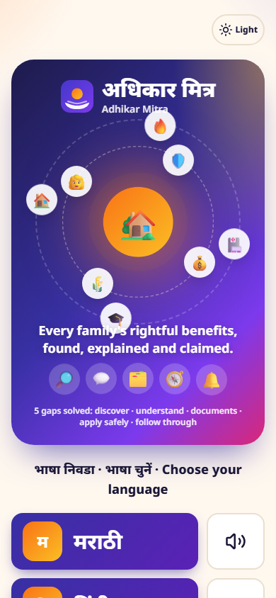
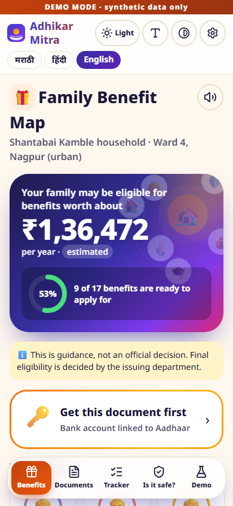
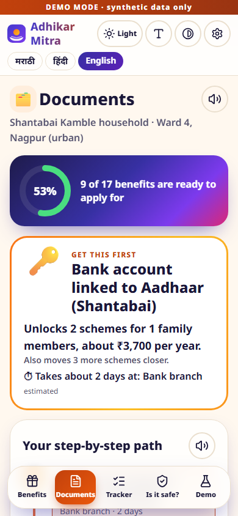
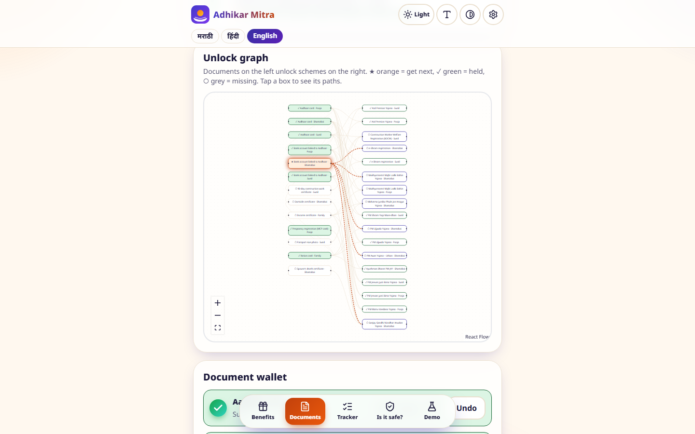
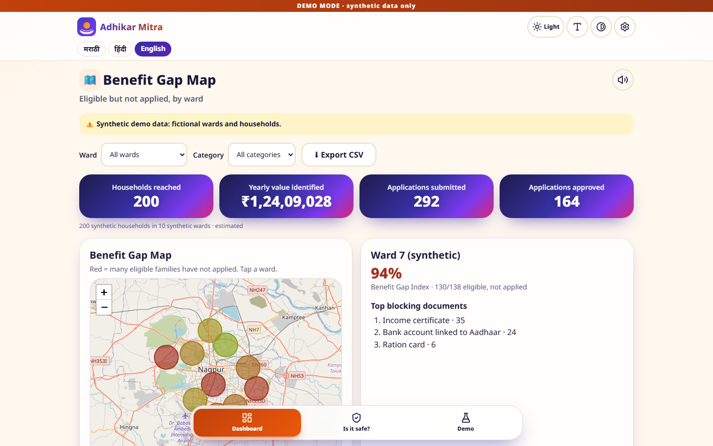
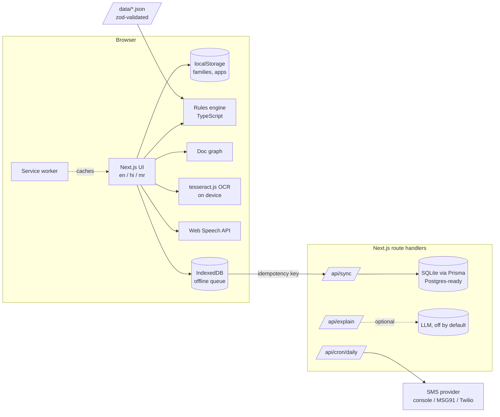

# Adhikar Mitra (अधिकार मित्र)

> **Every family's rightful benefits, found, explained and claimed.**

YCCE HackKumbh · Theme 03 Social Issues · PS 5: *Government Welfare Scheme Awareness and Application Assistant*
Team: `<TEAM_NAME>` (set in [`src/config/app.ts`](src/config/app.ts))

## The problem, in three sentences
Millions of families in urban slums and rural Vidarbha miss welfare benefits they are entitled to. They miss them not because of one gap but a chain of five: they do not know a scheme exists, cannot understand the rules, lack or mismatch a document, get pushed to paid middlemen, and cannot see why an application was rejected. Existing portals mostly solve only the first gap.

## What we built: eight differentiators

| | Differentiator | Where |
|---|---|---|
| A | **Document Unlock Graph**: schemes and documents as a dependency graph; tells the family the one document to get first | `src/lib/doc-graph`, `/documents` |
| B | **Household-first eligibility**: one questionnaire for every member, Family Benefit Map with estimated ₹/year | `/questionnaire`, `/benefits` |
| C | **Explainable rules engine**: deterministic, tested; every criterion shown as pass / fail / unknown. An LLM may only rephrase | `src/lib/eligibility`, `docs/RULES_ENGINE.md` |
| E | **Sahayak mode**: helpers manage many families from one device, offline-safe, no duplicates on sync | `/sahayak`, `src/lib/offline` |
| F | **Life-event triggers**: re-evaluates on life changes and time (turning 60, pregnancy…), notifies proactively | `/demo`, `src/lib/life-events` |
| G | **Rejection Decoder + Mismatch Detector**: OCR a rejection notice → plain reason and fix; name/DOB/gender mismatches flagged before submission | `/decoder`, `/mismatch` |
| H | **Scam Shield**: "Official ✓" only for allow-listed hosts; paste any message to check it | `/scam-check`, `<SafeLink>` |
| I | **Benefit Gap Map**: ward-level map of eligible-but-not-applied families and the top blocking document | `/admin` |

Design: a "sunrise over Vidarbha" look (indigo + saffron), glass cards, an orbiting-benefits hero, progress rings, a journey-style document path, confetti when a document is marked held or a scheme unlocks, and a floating dock navigation; all motion respects reduced-motion settings.

Plus Hindi / Marathi / English throughout, read-aloud, voice answers, large-text and high-contrast modes.

## Screenshots

| Landing | Family Benefit Map | Document unlock path |
|---|---|---|
|  |  |  |

| Unlock graph | Benefit Gap Map |
|---|---|
|  |  |

More in [`docs/screenshots/`](docs/screenshots) (regenerate with `npm run screenshots`).

## Architecture



More diagrams (eligibility flow, graph algorithm, offline sync) in [`docs/ARCHITECTURE.md`](docs/ARCHITECTURE.md).

## Run it (under five commands)

```bash
npm i
cp .env.example .env
npx prisma db push
npm run seed
npm run demo
```

Open <http://localhost:3000>. `npm run demo` builds the app once (about a minute) and then every page opens instantly. On Windows PowerShell use `copy .env.example .env`. `npm run dev` also works, but in dev mode each page compiles the first time you open it (several seconds), which can look like the app is frozen. Node 20+ is recommended; if `npm i` complains about peer dependencies, add `--legacy-peer-deps`. Fonts are bundled, so no internet is needed except for map tiles and the first OCR run.

The app starts in **Light** theme. Use the sun/moon button in the header (or Settings) to switch between Light, Dark and Auto.

Other scripts: `npm test` (unit), `npm run e2e` (Playwright), `npm run screenshots`, `npm run lint`, `npm run typecheck`, `npm run build`, `npm run docs:sources`, `npm run assets`.

**Switching to PostgreSQL** (Neon / Supabase): in `prisma/schema.prisma` change `provider = "sqlite"` to `"postgresql"`, set `DATABASE_URL` to your connection string, then run `npx prisma db push` and `npm run seed`.

## Demo logins (no real accounts)
- **Citizen:** any 10-digit number; the OTP is shown on screen (**Demo OTP: 1234**). Or tap a demo family on the login page.
- **Roles (no passwords):** open `/en/demo` and switch between Citizen 1 (Shantabai), Citizen 2 (Ramesh), Sahayak, and NGO Admin.
- **Demo hub** has the time-travel slider, life-event simulator, "Run daily check", SMS simulator and "Reset demo data".

Works with **no API keys**. The optional extras are off by default: LLM rephrasing (`LLM_PROVIDER`, `LLM_API_KEY`, `LLM_MODEL`), real SMS (`SMS_PROVIDER=msg91|twilio`), Bhashini voice.

## Honesty disclaimer
- All people, documents, wards and households are **synthetic**. Sample documents are watermarked "SAMPLE". Only the last 4 digits of an Aadhaar number are ever stored.
- Scheme rules were seeded from public knowledge and are **pending verification** (`verified: false`, `lastVerified: null`). Uncertain values carry `VERIFY`. See [`docs/DATA_SOURCES.md`](docs/DATA_SOURCES.md). Rupee values are rough *estimates*.
- Results are guidance, not an official decision. **No government system is integrated**; the tracker is updated by the user.
- Adhikar Mitra never asks for money or OTP.

## Docs
[ARCHITECTURE](docs/ARCHITECTURE.md) · [TRACEABILITY](docs/TRACEABILITY.md) · [DATA_SOURCES](docs/DATA_SOURCES.md) · [RULES_ENGINE](docs/RULES_ENGINE.md) · [DECISIONS](docs/DECISIONS.md) · [DEMO_SCRIPT](docs/DEMO_SCRIPT.md) · [PPT_CONTENT](docs/PPT_CONTENT.md)

## Licence
MIT, see [LICENSE](LICENSE).
