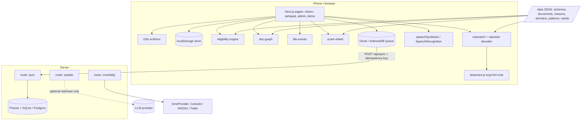
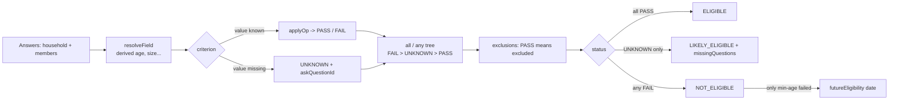

# Architecture

## 1. System



User data lives in the device store and (for assisted families) the database. Reference data (schemes, documents, scam patterns) lives in versioned JSON and is validated with zod at load time.

## 2. Eligibility flow (deterministic)



The LLM, if configured, only rephrases the template text produced from this output (`/api/explain` re-runs the engine on the server; the client cannot change the verdict).

## 3. Document Unlock Graph

```mermaid
flowchart TB
  N[Needs: eligible/likely scheme x member] --> M[required slots minus held slots = missing]
  M --> O[obtainSet(slot) = slot + unmet prerequisites, prerequisites first]
  O --> F[Fully unlocked: needs whose missing becomes empty]
  O --> P[Partial: needs whose missing count drops]
  F --> S[score = full value + 0.3 x partial value, divided by effort days]
  P --> S
  S --> R[rank; ties by members helped]
  R --> G[greedy path: take best, mark held, re-rank, repeat]
```

A *slot* is a document for a person or the household (`aadhaar|sunil`, `income-certificate|-`). Household documents are satisfied by any member's Aadhaar. Cycles in `documents.json` are rejected at load.

## 4. Offline sync (no duplicates)

```mermaid
sequenceDiagram
  participant S as Sahayak UI
  participant Q as IndexedDB queue
  participant A as /api/sync
  participant D as Database
  S->>Q: enqueue(family, idempotencyKey) [offline OK]
  Note over Q: state PENDING (survives reload)
  S->>A: flush when online
  A->>D: tx: find by key; else insert household + SyncRecord(UNIQUE key)
  D-->>A: created
  A--xS: response lost (network drop)
  Q->>Q: mark FAILED (retryable)
  S->>A: retry with the SAME key
  A->>D: key exists -> duplicate
  A-->>S: duplicate (same householdId)
  Q->>Q: mark SYNCED
```

Unique constraints on `Household.clientId` and `SyncRecord.idempotencyKey` make concurrent sends safe too. Covered by `tests/unit/flows.test.ts`.
